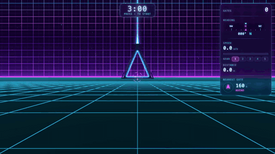

# vaporwave-visualizer

Pass through as many neon gates as you can in 3 minutes. A three.js scene based on `image-refs/vaporwave-space.png`: a striped pink-to-violet
sky with stars and a glowing horizon over an endless neon grid you can cruise around.

[](docs/demo.mp4)

▶ [Watch the full demo with sound (MP4, 24 s)](docs/demo.mp4)

## Controls

| Key | Action |
|---|---|
| ↑ / ↓ | Move forward / back |
| ← / → | Turn left / right |
| Q / W | Shift gear down / up (1–5) |
| Shift | Boost (2.5× the current gear) |
| M | Mute / unmute |
| Enter / R | Play again after time is up |
| ` (backtick) | Sound lab (dev panel); or open the page with `?dev` |

## Run

```bash
bun install
bun run dev      # dev server with hot reload at http://localhost:3000
bun run start    # same server without hot reload (PORT=8080 to change the port)
bun run build    # static build into ./dist, servable by any static host
bun check        # type check
bun run sounds   # convert sounds-src/*.wav → public/sounds/*.ogg
bun run demo     # re-record docs/demo.mp4 and docs/demo.gif (needs Google Chrome + ffmpeg)
```

## Layout

- `index.ts` – `Bun.serve` server for `index.html`
- `src/main.ts` – renderer, camera, render loop
- `src/world.ts` – sky, stars and grid floor (custom shaders)
- `src/movement.ts` – arrow-key movement (also reports speed, heading, distance)
- `src/hud.ts`, `src/hud.css` – top-right HUD (gate score, heading tape, speedometer, gears, odometer, nearest gate) and center crosshair
- `src/audio/` – sound (see below)
- `src/round.ts`, `src/clock.ts`, `src/clock.css` – 3-minute round: starts on your first arrow key, counts down at the top of the screen, stops scoring at 0:00 (`?time=<seconds>` for a shorter test round)
- `src/score.ts` – gate score: +1 the first time you fly through each gate (resets on reload)
- `src/popups.ts` – neon text popups in the scene (the new gate total, e.g. "GATES 3") that drift toward the camera and fade
- `src/gates.ts` – neon triangle gates, one every 4000 units (`GATE_SPACING`), each with a sky beam pulsing every 1.5 s (`PULSE_PERIOD`)

## Sound

Audio starts after the first key press or click (browser rule).

- `sounds-src/{sfx,ambience}/` – master `.wav` files (not served)
- `public/sounds/{sfx,ambience}/` – `.ogg` files (Opus, 160 kbps, 48 kHz) the game loads from `/sounds/...`
- `scripts/record-demo.ts` – `bun run demo` plays a scripted round in headless Chrome frame by frame,
  mixes the game's sounds offline (distance + stereo pan for 3D sounds) and encodes the README demo
- `scripts/convert-sounds.ts` – `bun run sounds` converts new or changed masters with ffmpeg (`--force` redoes all)
- `src/audio/sounds.ts` – manifest: every sound's file, mixer bus, volume, loop and 3D settings
- `src/audio/engine.ts` – the engine. three.js `AudioListener` rides on the camera and
  `PositionalAudio` handles loops attached to scene objects; plain Web Audio handles mixer
  buses (sfx / ambience / ui), loading, overlapping one-shots and ambience crossfades
- `src/audio/world-audio.ts` – what plays when: gate hum on every gate, a pulse in time with
  the beam flash, a whoosh when flying through a gate, gear and boost sounds
- `src/audio/dev-panel.ts` – the sound lab

### Adding a sound

1. Drop the `.wav` into `sounds-src/sfx/` or `sounds-src/ambience/` and run `bun run sounds`
   (needs ffmpeg with libopus: `brew install ffmpeg`).
2. Add an entry to `SOUNDS` in `src/audio/sounds.ts` (add `spatial` to make it a 3D sound).
3. Trigger it from `src/audio/world-audio.ts`:
   - `engine.play("id")` – one-shot (pass `{ position }` to place it in the world)
   - `engine.positional("id", object)` – looping sound attached to a scene object
   - `engine.setAmbience("id")` – crossfade the background bed (also list it in `AMBIENCES`)

Missing files only log a warning, so you can add entries before the audio exists.

### Sound lab

Press backtick to open it. It lists every manifest sound plus any audio file in `public/sounds`
that isn't in the manifest yet (marked `*`). You can play or loop each one, mix the buses and
switch the ambience. **Place 40u ahead** drops a test emitter playing the selected sound:
fly around it to hear panning and distance, tune volume, distance and cone with the sliders,
then **Copy entry** to paste the tuned settings into `sounds.ts`.
